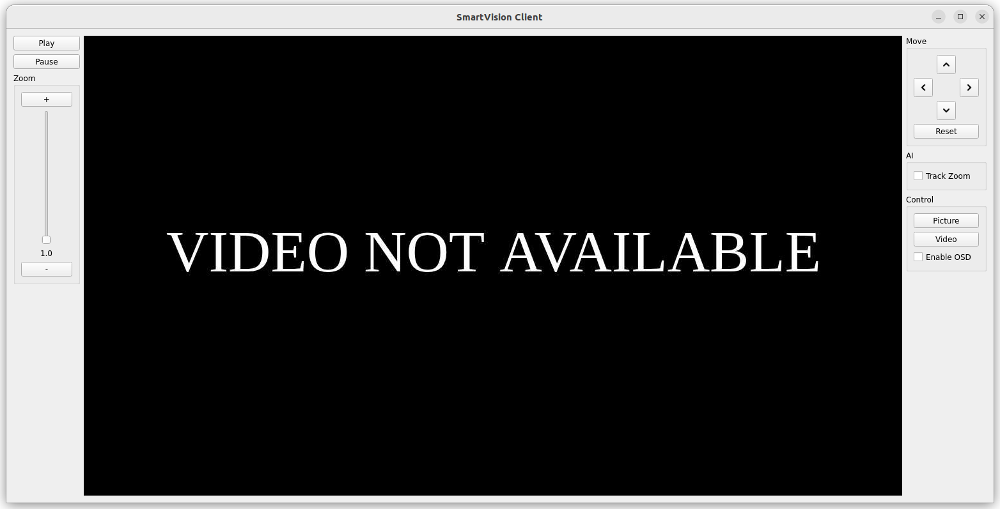

# Smartvision Client

Client application for Smartvision System build in Pyqt5. The application provides access to server application RTSP stream and functions.

## Features

- **Real-time Video Streaming**: Displays a live feed from the Smartvision System.
- **Zoom Control**: Allows zoom control with a slider and buttons.
- **PTZ Control**: Move camera.
- **Auto Zoom**: Toggle auto zoom during target tracking.
- **AI Tracking**: Toggle AI tracking selecting a target.
- **Control Panel**:
  - **Snapshot Capture**: Save current frame as an image.
  - **Video Recording**: Record video.
  - **OSD (On-Screen Display)**: Toggle overlay stream information.

## Prerequisites

Docker and docker-compose.

## Usage

1. **Allow docker access to the display**: 
   ```bash
   xhost +local:docker
   ```

2. **Run the container**:
   ```bash
   docker compose up
   ```

3. **Stop the container**:
   ```bash
   docker compose down
   ```



## How it works

The application await for a broadcast message from the Smartvision System. The message has the following json structure:
```json
{
  "device": "smartvision_system",
  "ip": "0.0.0.0",
  "rtsp": 8554,
  "cmd": 5005
}
```

After receiving the message, the application displays the RTSP stream from `rtsp://<ip>:<rtsp>/video` and sends UDP commands to `<ip>:<cmd>`.

The GUI state is updated after every status message received from the server application. Status messages are sent every 500ms and have the following json structure:

```json
{
  "zoom": "ZOOM_LEVEL",
  "pan": "PAN_ANGLE",
  "tilt": "TILT_ANGLE",
  "autoZoom": "AUTO_ZOOM_ENABLED",
  "osdEnabled": "OSD_ENABLED",
  "recording": "RECORDING"
}
```

## License

MIT License
